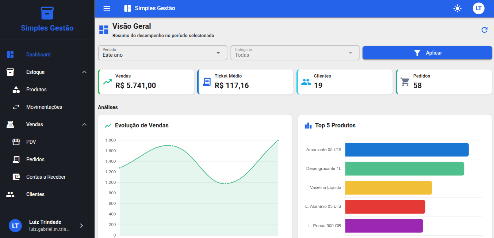

<div align="center">

# Sistema de Gerenciamento Corporativo (Frontend) — Simples Gestão

### Trabalho Acadêmico — Big Data Python

**Faculdade FACI Wyden**

</div>

<div align="center">

[](https://vuejs.org/)
[](https://quasar.dev/)
[](https://vitejs.dev/)
[](https://tanstack.com/query/latest/docs/framework/vue/overview)
[](https://pinia.vuejs.org/)
[](https://www.chartjs.org/)
[](https://www.gnu.org/licenses/agpl-3.0.html)

</div>

> Interface web responsiva (SPA) desenvolvida para consumir a API REST do sistema de gerenciamento, oferecendo uma experiência **mobile-first**, com suporte nativo a **Modo Escuro**, dashboards interativos com Chart.js, um **PDV (Ponto de Venda)** com geração de comprovante em formato de cupom térmico e um **Assistente Analítico com IA** conectado a uma base minerada de **Big Data & KDD**.

---



---

## 👥 Participantes

- **Caio Pantoja Correa** — 202302416071
- **Jessica Freire Carvalho** — 202404170527
- **Lohhana Lima Pinheiro** — 202508864207
- **Luiz Gabriel Magalhães Trindade** — 202302954812
- **Paulo Henrique Magno Moura** — 202302416081

**Orientadora:** Prof.ª Me. Larissa de Paula Serrão Garcia

---

## 🎓 Sobre o Projeto (Frontend)

Este repositório contém a aplicação **Single Page Application (SPA)** que compõe a camada de apresentação e visualização analítica do **Simples Gestão**. Desenvolvido com **Vue.js 3** e **Quasar Framework**, o frontend prioriza a experiência do usuário (UX) em dispositivos móveis sem perder funcionalidade em desktops.

A aplicação se comunica com o backend Django via **API REST**, gerenciando autenticação JWT, cache de dados com **TanStack Vue Query**, estado global com **Pinia** e renderização dinâmica de relatórios e gráficos gerados pelo cruzamento entre transações internas do ERP e **Dados Abertos Governamentais (KDD)**.

## 📑 Sumário

- [Arquitetura do Frontend](#-arquitetura-do-frontend)
- [Módulos da Interface](#-módulos-da-interface)
- [Destaques de Implementação](#-destaques-de-implementação)
- [Inteligência Analítica (IA), Big Data e KDD no Frontend](#-inteligência-analítica-ia-big-data-e-kdd-no-frontend)
    - [Experiência Visual e Motor Semântico de Gráficos](#1-experiência-visual-e-motor-semântico-de-gráficos-relatorios-iavue)
    - [Bases Públicas Governamentais e Fundamentação Legal](#2-bases-públicas-governamentais-e-fundamentação-legal)
    - [Arquitetura Desacoplada (> 3 GB Offline vs. Camada Gold)](#3-arquitetura-desacoplada--3-gb-offline-vs-camada-gold)
- [Tecnologias Utilizadas](#️-tecnologias-utilizadas)
- [Como Executar Localmente](#-como-executar-o-frontend-localmente)
- [Integração com o Backend](#-integração-com-o-backend)
- [Licença](#-licença)

---

## 🏛️ Arquitetura do Frontend

O projeto segue as melhores práticas do ecossistema Vue.js, utilizando a **Composition API** (`<script setup>`) e uma estrutura de pastas organizada pelo Quasar CLI:

- **`src/layouts/`**: Define o esqueleto principal da aplicação (cabeçalho superior, barra de navegação inferior estilo mobile, menu lateral).
- **`src/pages/`**: Contém as views principais do sistema (Dashboard, Relatórios IA/KDD, Vendas, Estoque, Clientes, Configurações).
- **`src/components/`**: Componentes de UI reutilizáveis e desacoplados (`LineChart.vue`, `BarChart.vue`, `DoughnutChart.vue`).
- **`src/router/`**: Configuração das rotas e guardas de navegação (Vue Router).
- **`src/boot/`**: Inicialização de plugins (Axios com interceptadores JWT, TanStack Vue Query).
- **`src/stores/`**: Gerenciamento de estado global da aplicação (Pinia) — usado para autenticação e preferências de UI.
- **`src/css/`**: Variáveis CSS customizadas e configurações de temas (Claro/Escuro).

### Gerenciamento de Estado em Duas Camadas

| Camada                   | Ferramenta         | Responsabilidade                                                                            |
| ------------------------ | ------------------ | ------------------------------------------------------------------------------------------- |
| **Estado do Servidor**   | TanStack Vue Query | Cache de dados da API, revalidação, sincronização entre páginas, `isLoading`/`isPending`    |
| **Estado Global do App** | Pinia              | Autenticação (usuário logado, tokens), preferências de UI (tema claro/escuro), notificações |

Essa separação evita o anti-padrão de replicar dados do servidor dentro de stores — o Vue Query é a única fonte de verdade para dados remotos.

---

## 📱 Módulos da Interface

- **Dashboard (`/`)**: Visão geral com cards de KPIs (Vendas, A Receber, Clientes, Estoque) e gráficos interativos (Linha e Rosca) utilizando Chart.js.

- **Assistente de Relatórios IA & KDD (`/relatorios-ia`)**: Chat analítico inteligente com alternância entre consultas operacionais (**ERP**) e mineração de mercado (**KDD**), renderização dinâmica de gráficos Chart.js com cores semânticas, tabelas responsivas, modal explicativo da arquitetura KDD e exportação de relatórios.

- **Vendas (`/vendas`)**: Hub de navegação para gestão de **Pedidos de Venda** e **Contas a Receber**.
    - **Pedidos (`/vendas/pedidos`)**: Tabela responsiva com CRUD completo. Criação de pedidos com adição de itens, cálculo automático de subtotais e total. Ação de **Comprovante de Venda** que abre um dialog maximized renderizando um cupom em formato **papel térmico** (ver [Destaques](#-destaques-de-implementação)).

- **Estoque (`/estoque`)**: Hub de navegação para cadastro de **Produtos** e registro de **Movimentações**.
    - **Produtos (`/estoque/produtos`)**: Listagem com busca em tempo real, badges de saldo (positivo/negativo) e status (ativo/inativo). Ações de editar, excluir e movimentar.
    - **Movimentações (`/estoque/movimentacoes`)**: Registro de entradas e saídas de estoque, com filtros por tipo, produto e busca textual. Cada movimentação impacta diretamente o saldo do produto.

- **Clientes (`/clientes`)**: Tabela responsiva com listagem, filtragem em tempo real, paginação e ações de CRUD (Criar, Visualizar, Editar, Excluir).

- **Configurações (`/config`)**: Central de preferências do usuário, incluindo o toggle de **Modo Escuro/Claro** persistente e opção de logout.

---

## ✨ Destaques de Implementação

### 🧾 Comprovante de Venda (Cupom Térmico)

Ao clicar em **"Ver itens do pedido"** na listagem, um dialog maximized renderiza um comprovante com aparência de **cupom fiscal de impressora térmica**:

- **Papel off-white** (`#fdfbf3`) com cantos serrilhados (efeito de papel picotado via gradientes CSS).
- **Fonte monoespaçada** (`Courier New`) em todo o papel.
- **Separadores literais** (`=====` e `-----`) em vez de bordas — visual realista.
- **Cabeçalho** com "COMPROVANTE DE VENDA" + "NÃO É DOCUMENTO FISCAL".
- **Resolução de itens**: como a API de pedidos devolve apenas IDs de movimentações (`movimentacoes: [14]`), o frontend cruza com o cache de `/movimentacoes/` (mesma `queryKey`, zero fetch duplicado) e normaliza os campos.
- **Botão de impressão** que abre uma janela dedicada com CSS `@media print` otimizado.
- **100% responsivo**: no desktop aparece como papel centralizado sobre fundo cinza; no mobile ocupa a tela inteira sem sombras.

### 📊 Cache Compartilhado com Vue Query

Uso intensivo de `queryKey` consistente entre páginas (ex.: `['produtos']`, `['movimentacoes']`) permite que dados sejam reaproveitados entre telas sem novo fetch. Ao criar/editar/excluir um pedido, `invalidateQueries` revalida automaticamente as queries afetadas — a UI se atualiza em background sem código imperativo.

### 📱 Mobile-First de Verdade

- Tabelas responsivas com scroll horizontal nativo do Quasar (sem `min-width` forçado).
- Dialogs maximized com `max-width` + `margin: auto` em desktop, `100vw/100vh` em mobile.
- Botões de ação (`q-btn`) com `full-width` em telas pequenas via `$q.screen.lt.sm`.
- Breadcrumbs, headers e formulários adaptados para toque e leitura em telas estreitas.

### 🎨 Modo Escuro Persistente

Preferência de tema gerenciada via Pinia + `LocalStorage`, com detecção automática da preferência do sistema operacional no primeiro acesso.

---

## 🧠 Inteligência Analítica (IA), Big Data e KDD no Frontend

A tela **`src/pages/relatorios-ia.vue`** atua como a camada de **Interpretação e Visualização** do processo **KDD (_Knowledge Discovery in Databases_)**, permitindo que o gestor interrogue em linguagem natural tanto o banco transacional do ERP quanto os modelos minerados sobre bases públicas massivas.

### 1. Experiência Visual e Motor Semântico de Gráficos (`relatorios-ia.vue`)

- **Seletor de Contexto (`KDD` vs. `ERP`):** Alterna instantaneamente os atalhos de consulta rápida entre diagnósticos de Big Data (Diagnóstico Completo ERP × KDD, Leads B2B no Pará via Receita Federal, Combos Apriori e Risco de Crédito vs. Banco Central) e operações internas (Previsão de Demanda, Vendas, Estoque Crítico e Contas a Receber).
- **Motor Semântico de Cores (`resolveSemanticColor`):** Analisa automaticamente os rótulos, títulos e valores numéricos recebidos da API (normalizando acentos e contexto) para colorir cada barra, fatia ou linha conforme seu significado de negócio:
    - 🔴 **Vermelho (`#E53935`):** Indicadores críticos, parcelas vencidas, atrasos, estoque zerado (`<= 0`), rupturas e risco alto.
    - 🟠 **Âmbar/Laranja (`#FB8C00`):** Alertas moderados, baixo giro, juros, custo de capital de giro e excesso de estoque.
    - 🟢 **Verde Esmeralda (`#10B981`):** Fluxo saudável, valores a receber no prazo, faturamento e metas atingidas.
    - 🟣 **Índigo (`#6366F1`):** Benchmarks externos e indicadores oficiais (Banco Central, ANVISA, Receita Federal), garantindo contraste direto ao comparar métricas internas com médias de mercado.
    - 🔵 **Teal (`#00897B`):** Expansão comercial B2B e segmentos de prospecção (supermercados, minimercados, lavanderias, estética automotiva).
- **Controles Interativos nos Gráficos:** Permite alternar em tempo real entre **Barras Verticais**, **Barras Horizontais** e **Rosca (`Doughnut`)**, além de baixar qualquer gráfico diretamente como imagem **`.png`**.
- **Modal Metodológico (`Pipeline KDD`):** Apresenta ao usuário as 5 etapas do KDD e o volume real processado no backend.
- **Sanitização Segura e Exportação:** Converte Markdown/HTML estruturado com `DOMParser` (bloqueando tags inseguras, isolando tabelas com scroll horizontal e removendo artefatos ASCII) e permite exportar toda a sessão analítica em **Markdown (`.md`)**.

---

### 2. Bases Públicas Governamentais e Fundamentação Legal

Os indicadores exibidos nos relatórios KDD são extraídos diretamente de **Dados Abertos Governamentais** (_Open Government Data_), respaldados pela legislação federal brasileira:

- **Lei de Acesso à Informação — LAI (Lei Federal nº 12.527/2011):** Garante a transparência ativa e o acesso público a bases governamentais em formatos abertos e legíveis por máquina (Art. 8º, § 3º).
- **Política Nacional de Dados Abertos (Decreto Federal nº 8.777/2016):** Regulamenta a livre reutilização de bases públicas federais para inovação, pesquisa e inteligência de mercado.
- **Lei Geral de Proteção de Dados Pessoais — LGPD (Lei Federal nº 13.709/2018 — Art. 7º, §§ 3º e 4º):** Autoriza o tratamento de dados cadastrais tornados manifestamente públicos pelo poder público (incluindo registros de MEI e Empresário Individual), observadas a boa-fé e a finalidade legítima de prospecção B2B.

| Fonte Pública                 | Escopo Processado no Pipeline Backend                                 | O que é Visualizado no Frontend                                                                                                                        |
| :---------------------------- | :-------------------------------------------------------------------- | :----------------------------------------------------------------------------------------------------------------------------------------------------- |
| **Receita Federal (CNPJ)**    | **40.535.334 estabelecimentos** varridos (`Estabelecimentos0..2.zip`) | **12.396 potenciais compradores B2B ativos** no Pará segmentados via **K-Means** vs. **22 fabricantes concorrentes**, com lista de leads prioritários. |
| **ANVISA**                    | **1.362.636 registros** de produtos saneantes e cosméticos            | Benchmark regulatório de mercado e inteligência competitiva de catálogo.                                                                               |
| **Banco Central (BCB — SGS)** | Séries históricas de **36 meses** (Séries `21083`, `21084` e `20786`) | Comparativo visual entre a inadimplência do ERP e a média PJ oficial (**3,28% a.m.**) + custo de capital de giro (**35,52% a.a.**).                    |
| **IBGE (SIDRA — Tab. 7060)**  | IPCA setorial dos últimos **24 meses** (Limpeza e Higiene)            | Contexto inflacionário para precificação e projeção de demanda.                                                                                        |
| **ERP Interno + Apriori**     | Cestas de pedidos reais do Simples Gestão                             | Regras de associação (**Suporte, Confiança e Lift de até 2,5x**) sugerindo kits promocionais para aumento de ticket médio.                             |

---

### 3. Arquitetura Desacoplada (> 3 GB Offline vs. Camada Gold)

Para que o frontend e a API respondam em milissegundos sem exigir máquinas pesadas em produção, o pipeline batch do backend baixa e processa **mais de 3 GB de dados brutos** localmente (arquivos `.zip` da Receita Federal e `.csv` da ANVISA nas camadas Bronze/Silver, ignoradas no GitHub devido aos limites de tamanho de repositório), versionando **apenas a Camada Gold (`datalake/gold/kdd_resumo.json`, < 5 KB)**. O frontend consome essa inteligência de forma transparente através do endpoint `POST /api/relatorios-ia/`.

---

## 🛠️ Tecnologias Utilizadas

- **Framework Principal:** Vue.js 3 (Composition API + `<script setup>`)
- **UI Framework:** Quasar Framework (v2.x)
- **Build Tool:** Vite (via Quasar CLI)
- **Roteamento:** Vue Router
- **Estado do Servidor:** TanStack Vue Query (`@tanstack/vue-query`)
- **Estado Global:** Pinia
- **Visualização de Dados:** Chart.js + `vue-chartjs`
- **Requisições HTTP:** Axios
- **Gerenciador de Pacotes:** pnpm (recomendado), npm ou yarn

---

## 🚀 Como Executar o Frontend Localmente

### Pré-requisitos

- [Node.js](https://nodejs.org/) (versão LTS recomendada: 20.x ou superior)
- [pnpm](https://pnpm.io/installation) (ou npm/yarn)
- O **Backend Django** rodando (para autenticação e consumo dos endpoints REST e `/relatorios-ia/`)

### Passos

1. **Clone o repositório do frontend:**

    ```bash
    git clone <URL_DO_SEU_REPOSITORIO_FRONTEND>
    cd sistema-gerenciamento-frontend
    ```

2. **Instale as dependências:**

    ```bash
    pnpm install
    ```

3. **Configure as variáveis de ambiente:**
   Crie um arquivo `.env` na raiz do projeto (baseado no `.env.example`, se disponível) apontando para a URL da API backend:

    ```env
    VITE_API_URL=http://localhost:8000/api
    ```

4. **Inicie o servidor de desenvolvimento:**

    ```bash
    pnpm dev
    ```

5. **Gerar build otimizado para produção (SPA):**

    ```bash
    pnpm build
    ```

---

## 🔌 Integração com o Backend

O frontend comunica-se com a API REST do **Simples Gestão** utilizando instâncias configuradas do **Axios** (`src/boot/axios.js`) com anexação automática de tokens JWT (`Bearer`) e renovação transparente de sessão:

- **`/api/token/` & `/api/token/refresh/`**: Autenticação JWT.
- **`/api/vendas/` & `/api/contas-receber/`**: Gestão de pedidos, parcelas e geração de comprovantes térmicos.
- **`/api/estoque/produtos/` & `/api/estoque/movimentacoes/`**: Controle de catálogo e movimentações em tempo real.
- **`/api/clientes/`**: Cadastro e consulta de clientes PF/PJ.
- **`/api/relatorios-ia/`**: Endpoint conversacional que aciona o agente IA, consulta os dados do ERP + **Camada Gold KDD** e devolve respostas formatadas acompanhadas do payload estruturado (`chart` e `data`) para renderização automática no Chart.js.

---

## 📄 Licença

Este projeto está licenciado sob a **GNU Affero General Public License v3.0 (AGPL-3.0)**.

<div align="center">

[](https://www.gnu.org/licenses/agpl-3.0.html)

Consulte o arquivo [`LICENSE`](LICENSE) para mais detalhes.

</div>
